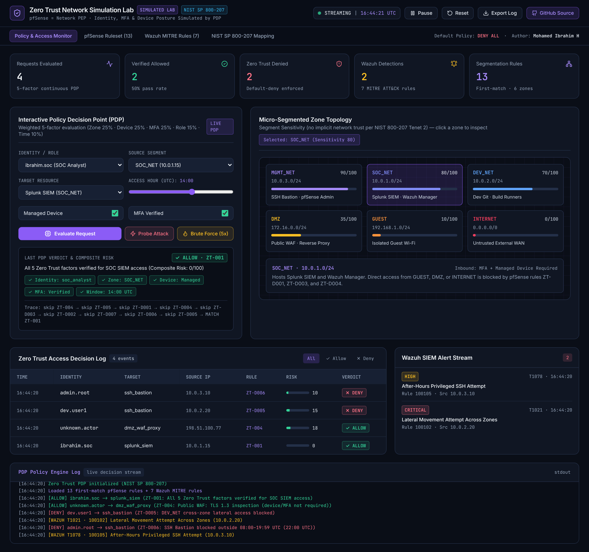
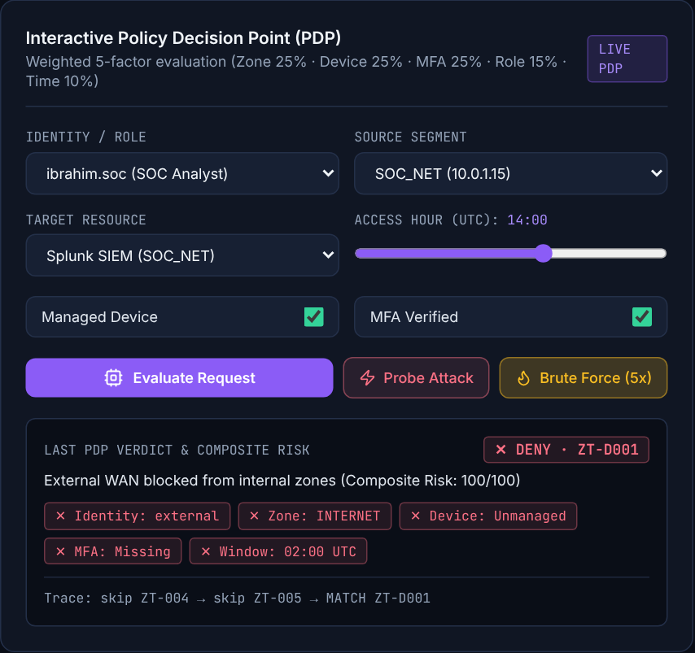
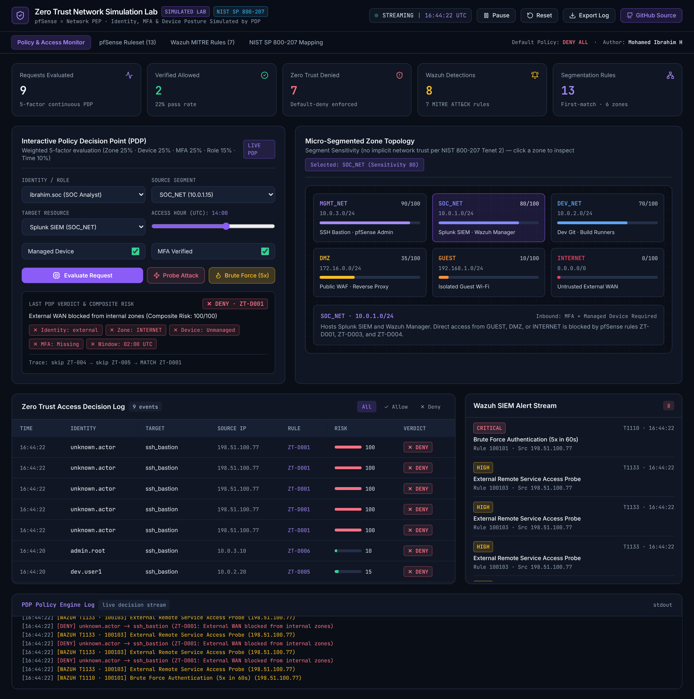
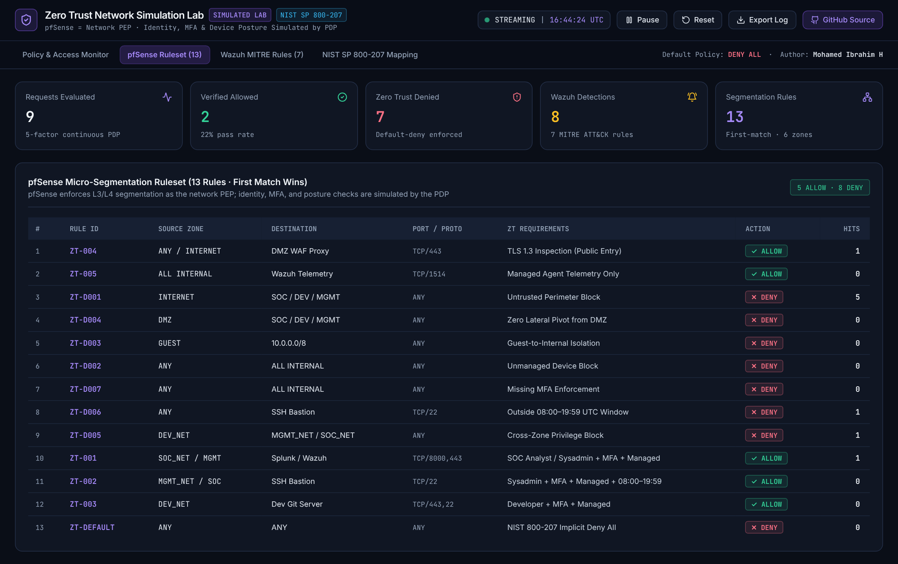
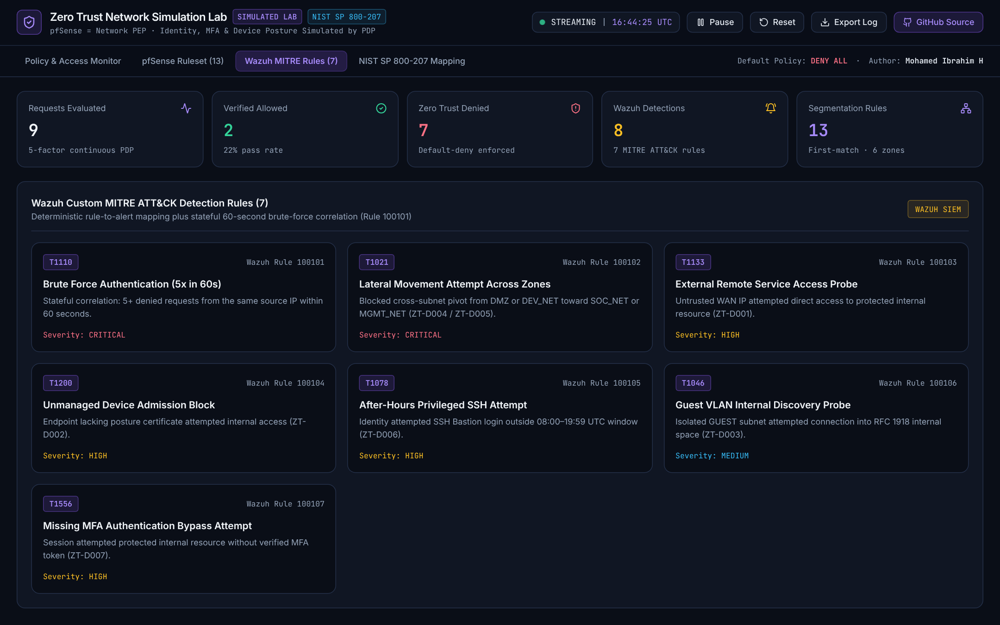
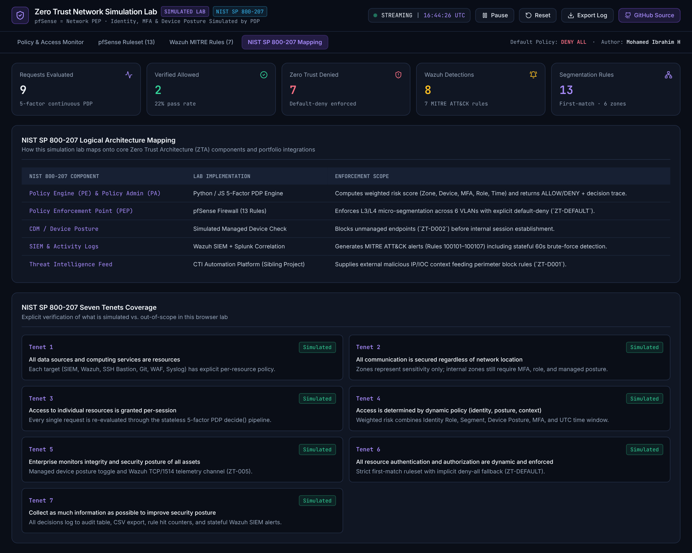
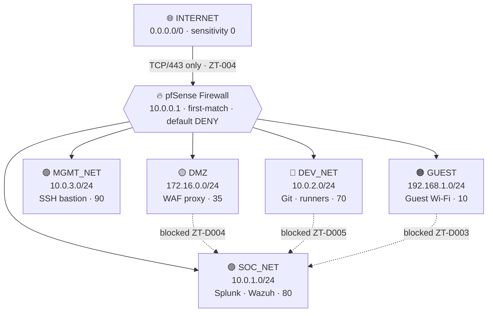

<div align="center">

# 🔐 Zero Trust Network Simulation Lab

**Identity-aware micro-segmentation with continuous verification, mapped to NIST SP 800-207**

*pfSense · Wazuh · VirtualBox · Python Policy Engine · MITRE ATT&CK*


<br>



<sub>Policy & Access Monitor: interactive PDP, segment topology, access decision log and Wazuh alert stream</sub>

</div>

---

## 📑 Table of Contents

[Overview](#-overview) · [Dashboard Tour](#%EF%B8%8F-dashboard-tour) · [Architecture](#%EF%B8%8F-network-architecture) · [Policy Engine](#-zero-trust-policy-engine) · [pfSense Rules](#%EF%B8%8F-pfsense-ruleset-13-rules) · [Detections](#-wazuh-mitre-attck-detections) · [NIST Mapping](#-nist-sp-800-207-mapping) · [Setup](#%EF%B8%8F-setup--run) · [Scope](#%EF%B8%8F-honest-scope) · [Roadmap](#%EF%B8%8F-roadmap) · [Author](#-author)

---

## 📌 Overview

A **Zero Trust Network Architecture (ZTNA)** simulation built with VirtualBox VMs, a pfSense firewall and Wazuh SIEM, aligned to the **NIST SP 800-207** standard.

> **"Never Trust. Always Verify."** Every request is denied by default, then verified against **identity, device posture, segment, MFA and time window** before access is granted.

| 🧱 Micro-segmentation | 🧠 Policy Decision Point | 🚨 Detection |
|---|---|---|
| 6 zones, 13 first-match pfSense rules, default `DENY ALL` | Weighted 5-factor composite risk with a full decision trace | 7 Wazuh MITRE ATT&CK rules including stateful brute-force correlation |

> ⚠️ **Scope note:** pfSense acts as the **network PEP (L3/L4 segmentation)**. Identity, MFA and device-posture checks are **simulated by the PDP**, as a production deployment would delegate them to an IdP / ZTNA proxy. The dashboard is a **browser simulation** with synthetic traffic (RFC 5737 addresses); it makes no live calls.

---

## 🖼️ Dashboard Tour

### 1️⃣ Policy & Access Monitor
KPI strip, interactive PDP, clickable zone topology, access decision log, Wazuh alert stream, and a live policy-engine terminal.


### 2️⃣ Policy Decision Point with Decision Trace
Pick an identity, segment, resource, hour, device and MFA state. The PDP returns **ALLOW / DENY**, the **rule that matched**, a **composite risk score**, per-factor pass/fail chips, and the **first-match trace** showing which rules were skipped.

<div align="center">

</div>

### 3️⃣ Stateful Brute-Force Detection
**Brute Force (5x)** fires five denied requests from one source IP. Wazuh rule `100101` correlates them inside a **60-second window** and raises a CRITICAL T1110 alert.



### 4️⃣ pfSense Ruleset (13, first-match)
Ordered ruleset with explicit order numbers, ALLOW/DENY actions, and `ZT-DEFAULT` implicit deny at the bottom.



### 5️⃣ Wazuh MITRE ATT&CK Detections
Seven custom detection rules, each tied to the firewall rule that triggers it.



### 6️⃣ NIST SP 800-207 Mapping
Lab components mapped to NIST logical architecture, plus a **seven-tenet coverage** view.



---

## 🏗️ Network Architecture



### Segments

| Zone | CIDR | Sensitivity | Hosts |
|---|---|:---:|---|
| `MGMT_NET` | 10.0.3.0/24 | **90** | SSH Bastion · pfSense Admin |
| `SOC_NET` | 10.0.1.0/24 | **80** | Splunk SIEM · Wazuh Manager |
| `DEV_NET` | 10.0.2.0/24 | **70** | Dev Git · Build Runners |
| `DMZ` | 172.16.0.0/24 | **35** | Public WAF · Reverse Proxy |
| `GUEST` | 192.168.1.0/24 | **10** | Isolated Guest Wi-Fi |
| `INTERNET` | 0.0.0.0/0 | **0** | Untrusted external WAN |

> **Sensitivity, not trust.** In line with NIST Tenet 2, a zone score expresses how *critical* the segment is, never that its traffic is implicitly trusted. Internal requests still need MFA, role and a managed device.

### 🖥️ VM Setup (VirtualBox)

| VM | OS | IP | Role |
|---|---|---|---|
| **pfsense-fw** | pfSense 2.7 | 10.0.0.1 | Firewall / Router (PEP) |
| **wazuh-siem** | Ubuntu 22.04 | 10.0.1.5 | Wazuh SIEM Server |
| **splunk-server** | Ubuntu 22.04 | 10.0.1.10 | Splunk Enterprise |
| **soc-workstation** | Ubuntu 22.04 | 10.0.1.15 | SOC Analyst WS |
| **dev-server** | Ubuntu 22.04 | 10.0.2.10 | Dev Server |
| **mgmt-server** | Ubuntu 22.04 | 10.0.3.5 | Admin Bastion |

---

## 🧠 Zero Trust Policy Engine

Each request is scored by a stateless `decide()` pipeline: **ALLOW** only when a matching allow rule fires, otherwise the first matching deny rule (or `ZT-DEFAULT`) applies.

### Weighted 5-Factor Composite Risk

| Factor | Weight | Check |
|---|:---:|---|
| 🌐 **Zone / Segment** | 25% | Source segment is permitted for the target resource |
| 💻 **Device Posture** | 25% | Managed, compliant endpoint |
| 🔑 **MFA** | 25% | Authenticated with verified MFA |
| 👤 **Role** | 15% | Role is authorized for the resource |
| 🕐 **Time Window** | 10% | Within 08:00–19:59 UTC for the SSH bastion |

### Evaluation Order (first match wins)

```
ZT-004 → ZT-005 → ZT-D001 → ZT-D004 → ZT-D003 → ZT-D002 → ZT-D007
       → ZT-D006 → ZT-D005 → ZT-001 → ZT-002 → ZT-003 → ZT-DEFAULT
```

### Example Decision Trace

```
Request : unknown.actor (external) from INTERNET -> ssh_bastion @ 02:00 UTC, unmanaged, no MFA
Trace   : skip ZT-004 → skip ZT-005 → MATCH ZT-D001
Verdict : DENY · External WAN blocked from internal zones (Composite Risk: 100/100)
Wazuh   : T1133 · Rule 100103 · External Remote Service Access Probe
```

---

## 🛡️ pfSense Ruleset (13 Rules)

| # | Rule | Source | Destination | Proto | Requirement | Action |
|:-:|---|---|---|---|---|:-:|
| 1 | `ZT-004` | ANY / INTERNET | DMZ WAF Proxy | TCP/443 | TLS 1.3 inspection (public entry) | ✅ ALLOW |
| 2 | `ZT-005` | ALL INTERNAL | Wazuh Telemetry | TCP/1514 | Managed agent telemetry only | ✅ ALLOW |
| 3 | `ZT-D001` | INTERNET | SOC / DEV / MGMT | ANY | Untrusted perimeter block | ⛔ DENY |
| 4 | `ZT-D004` | DMZ | SOC / DEV / MGMT | ANY | Zero lateral pivot from DMZ | ⛔ DENY |
| 5 | `ZT-D003` | GUEST | 10.0.0.0/8 | ANY | Guest-to-internal isolation | ⛔ DENY |
| 6 | `ZT-D002` | ANY | ALL INTERNAL | ANY | Unmanaged device block | ⛔ DENY |
| 7 | `ZT-D007` | ANY | ALL INTERNAL | ANY | Missing MFA enforcement | ⛔ DENY |
| 8 | `ZT-D006` | ANY | SSH Bastion | TCP/22 | Outside 08:00–19:59 UTC window | ⛔ DENY |
| 9 | `ZT-D005` | DEV_NET | MGMT_NET / SOC_NET | ANY | Cross-zone privilege block | ⛔ DENY |
| 10 | `ZT-001` | SOC_NET / MGMT | Splunk / Wazuh | TCP/8000,443 | SOC Analyst / Sysadmin + MFA + Managed | ✅ ALLOW |
| 11 | `ZT-002` | MGMT_NET / SOC | SSH Bastion | TCP/22 | Sysadmin + MFA + Managed + 08:00–19:59 | ✅ ALLOW |
| 12 | `ZT-003` | DEV_NET | Dev Git Server | TCP/443,22 | Developer + MFA + Managed | ✅ ALLOW |
| 13 | `ZT-DEFAULT` | ANY | ANY | ANY | NIST 800-207 implicit deny all | ⛔ DENY |

---

## 🚨 Wazuh MITRE ATT&CK Detections

| Rule | MITRE | Detection | Triggered by | Severity |
|---|---|---|---|:-:|
| `100101` | T1110 | Brute force: 5+ denied requests from one IP within 60s (**stateful**) | repeated denies | 🔴 CRITICAL |
| `100102` | T1021 | Lateral movement attempt across zones | `ZT-D004`, `ZT-D005` | 🔴 CRITICAL |
| `100103` | T1133 | External remote service access probe | `ZT-D001` | 🟠 HIGH |
| `100104` | T1200 | Unmanaged device admission block | `ZT-D002` | 🟠 HIGH |
| `100105` | T1078 | After-hours privileged SSH attempt | `ZT-D006` | 🟠 HIGH |
| `100106` | T1046 | Guest VLAN internal discovery probe | `ZT-D003` | 🔵 MEDIUM |
| `100107` | T1556 | Missing MFA authentication bypass attempt | `ZT-D007` | 🟠 HIGH |

---

## 🧭 NIST SP 800-207 Mapping

| NIST Component | Lab Implementation | Enforcement Scope |
|---|---|---|
| **Policy Engine & Policy Admin** | Python / JS 5-factor PDP | Weighted risk score (zone, device, MFA, role, time) with ALLOW/DENY and decision trace |
| **Policy Enforcement Point** | pfSense firewall (13 rules) | L3/L4 micro-segmentation across 6 VLANs, explicit default deny (`ZT-DEFAULT`) |
| **CDM / Device Posture** | Simulated managed-device check | Blocks unmanaged endpoints (`ZT-D002`) before session establishment |
| **SIEM & Activity Logs** | Wazuh + Splunk correlation | MITRE alerts (rules 100101–100107) incl. stateful 60s brute-force detection |
| **Threat Intelligence Feed** | [CTI Automation Platform](https://github.com/ibu-cyx0/CTI-Automation-Platform) (sibling project) | External malicious IP / IOC context supporting perimeter blocks (`ZT-D001`) |

<details>
<summary><b>📜 Seven Tenets Coverage</b> (simulated in this lab)</summary>

| Tenet | Principle | How the lab covers it |
|:-:|---|---|
| 1 | All data sources and computing services are resources | Each target (SIEM, Wazuh, SSH Bastion, Git, WAF, Syslog) has explicit per-resource policy |
| 2 | All communication is secured regardless of network location | Zones express sensitivity only; internal zones still require MFA, role and managed posture |
| 3 | Access is granted per session | Every request is re-evaluated by the stateless `decide()` pipeline |
| 4 | Access is determined by dynamic policy | Weighted risk from role, segment, device posture, MFA and UTC time |
| 5 | Enterprise monitors integrity and posture of all assets | Managed-device toggle and Wazuh TCP/1514 telemetry channel (`ZT-005`) |
| 6 | Authentication and authorization are dynamic and strictly enforced | Strict first-match ruleset with implicit deny-all fallback |
| 7 | Collect as much information as possible to improve posture | Audit table, CSV export, rule hit counters and stateful Wazuh alerts |

</details>

---

## 📁 Project Structure

```
zero-trust-lab/
├── policies/
│   └── policy_engine.py         # Zero Trust access evaluator
├── monitor/
│   ├── zt_monitor.py            # Wazuh-style alert correlation
│   ├── access_log.json          # All access events (auto-generated)
│   └── alerts.json              # Fired alerts (auto-generated)
├── scripts/
│   └── segmentation.py          # Network zone + pfSense rule generator
├── docs/
│   ├── screenshots/             # Dashboard screenshots used in this README
│   ├── pfsense_rules.xml        # pfSense firewall export
│   ├── firewall_rules.json      # Micro-segmentation rules
│   └── network_zones.json       # Zone definitions + host inventory
├── dashboard/
│   └── index.html               # Interactive Zero Trust lab dashboard
├── main.py                      # Full pipeline runner
└── README.md
```

---

## ⚙️ Setup & Run

```bash
git clone https://github.com/ibu-cyx0/Zero-Trust-Network-Simulation-Lab
cd Zero-Trust-Network-Simulation-Lab
pip install -r requirements.txt

# Run the full simulation pipeline
python main.py

# Open the dashboard
open dashboard/index.html
```

**Dashboard controls:** `Pause` / `Reset` the live stream, `Export Log` to CSV, click any **zone** to inspect it, and use **Probe Attack** or **Brute Force (5x)** to trigger detections on demand. Session state persists in the browser via `localStorage`.

> The dashboard loads Tailwind CSS and Lucide icons from public CDNs, so keep an internet connection on for the first load.

### 📊 Python Simulation Results

```
Access Requests Evaluated : 10
Requests Allowed          : 4  (40%)
Requests Denied           : 6  (60%)
Critical Alerts Fired     : 2
Total Alerts              : 7
Firewall Rules Applied    : 13
Network Zones Isolated    : 4
```

---

## ⚠️ Honest Scope

- **Simulation, not production.** The dashboard runs synthetic traffic in the browser; the VM lab provides the real pfSense and Wazuh components.
- **pfSense is a network PEP.** It enforces L3/L4 segmentation. MFA and device posture are simulated by the PDP; production needs an IdP and ZTNA proxy (for example Keycloak, Authelia or Tailscale).
- **Risk weights are illustrative.** The 25/25/25/15/10 weighting is a teaching model, not a calibrated score.
- **Threat intel link is conceptual.** The CTI platform is a sibling project; its feed is not wired into the firewall automatically yet.

---

## 🗺️ Roadmap

- [ ] OpenVPN + certificate-based identity
- [ ] Automated IP blocklist from Wazuh → pfSense
- [ ] LDAP / Active Directory integration
- [ ] Dashboard live Wazuh API integration
- [ ] Identity-aware proxy (Keycloak / Authelia) as a real identity PEP
- [ ] Feed the CTI Automation Platform IOCs into `ZT-D001` automatically
- [ ] Automated incident playbook (Python)

---

## 🛠️ Tech Stack

| Layer | Tools |
|---|---|
| **Network** | VirtualBox · pfSense 2.7 |
| **Policy engine** | Python 3.10+ (CLI) · JavaScript `decide()` (dashboard) |
| **Detection** | Wazuh · Splunk · MITRE ATT&CK |
| **Dashboard** | HTML · Tailwind CSS · JavaScript · Lucide |
| **Standard** | NIST SP 800-207 |

---

## 👤 Author

**Mohamed Ibrahim H**  
EC-Council Certified SOC Analyst (CSA) · Splunk Core Certified User · Cisco Cyber Ops Associate

[](https://github.com/ibu-cyx0)
[](https://tryhackme.com/p/IbrahimCyb3r4)
[](https://ibrahim-cybrx.is-a.dev/)
[](mailto:ibrahim.cybrx@gmail.com)

---

<div align="center">

**MIT License** · Built for SOC, detection engineering and Zero Trust architecture roles

</div>

